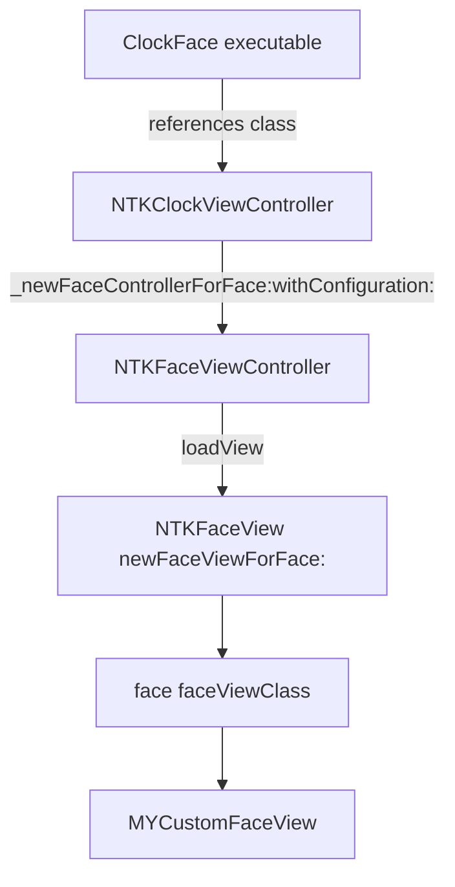
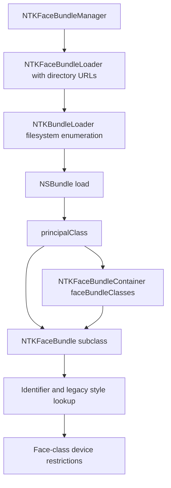

# Hosting and discovery research — watchOS 26.5 / 23T570

Evidence collected read-only from the installed simulator runtime on 2026-10-21.
Architecture: x86_64. NanoTimeKit UUID:
`BA6B817D-D837-37DA-9BD1-DB2D1FC9CAD3`.
Addresses below are unslid Mach-O addresses for that slice, not LLDB addresses.

## Repeatable evidence collection

From the repository root:

```sh
python3 Experiments/inspect-runtime.py > /tmp/WatchFaceLab26-NTK/runtime-evidence.json
```

The output contains the runtime path, UUIDs, bundle inventory, and selected
references from a fresh disassembly. It neither starts a process nor modifies
runtime files. Use `--runtime-root` or `WATCH_RUNTIME_ROOT` for another location.
The script verifies expected symbols exist and fails if they do not. Raw
Objective-C dispatch comments from llvm-objdump are not always trustworthy:
register-loaded selectors must be traced through the actual argument registers.

## Current experiment status

The user confirmed that the label displays and dismissing the preview restores
the SwiftUI app. This is stronger evidence than the earlier console output alone.
Repeated presentation/dismissal and a fresh-app-process repeat remain pending;
they have been requested in the existing debugger session. No automated lifecycle
success is claimed. A second debugger was previously rejected because Xcode owns
the process; this research does not detach Xcode or restart the user's session.

The present preview uses an ordinary UIViewController and a temporary UIWindow.
It exercises face initialization, view factory dispatch, UIKit layout and app
presentation, but does not exercise the native NTKFaceViewController lifecycle.

## Native hosting path

Static call/reference chain:



ClockFace's `Info.plist` declares identifier `com.apple.clockface` and executable
`ClockFace`. `nm -arch x86_64` on that executable reports imports for the class
and metaclass of NTKClockViewController. NanoTimeKit's
`-[NTKClockViewController _newFaceControllerForFace:withConfiguration:]` contains
the NTKFaceViewController class reference at 0x357c5e and initializer selector
reference at 0x357cb1. This supports ClockFace as a rendering host, but static
references do not prove the active scene's entire cross-process composition.

The live simulator service listing showed distinct processes for ClockFace,
Carousel, nanotimekitd, and WatchFaceLab. No system process was attached.

`-[NTKFaceViewController initWithFace:configuration:]` at 0x2a1513 has encoding
`@32@0:8@16@?24`. The final argument is a block, **not a configuration object**.
It observes the face, invokes complication migration, installs notification and
sensitive-UI observers, reads lock/backlight state, forces its view to load, and
registers with NTKLifecycleTracker. These extra dependencies make the existing
plain-controller result insufficient proof that native controller hosting works.

`loadView` at 0x2a1be0 (first inspected instruction in the body at 0x2a1bf4)
obtains or creates the face view, installs the controller as delegate, populates
resource/edit-option state and initial complication visibility, and places the
face view inside a wrapper view. It does not merely return the renderer directly.

`configureWithDuration:block:` at 0x2a4080 checks for a nil block; when non-nil it
invokes the block with the controller as the sole explicit argument, then applies
configuration. The initializer forwards its block with duration zero. Nil-block
acceptance at that point is verified statically; full nil-configuration controller
initialization has not been executed. No controller declaration or call was added.

`becomeActive` (0x2b0184) and `resignActive` (0x2b042d) have encoding `v16@0:8`.
Their bodies involve backlight/always-on state, complications, and Tritium
controllers. Configuration application includes renderer `setDataMode:`, override
dates, canonical/locked UI, and complication visibility. Data-mode integer
semantics and the actual clock update provider remain unresolved. In particular,
`_outputTime:` invokes AXTapToSpeakTimeManager; it is speech output, not evidence
of a rendering tick callback. Do not use that selector to implement a clock.

## Bundle discovery path



`+[NTKBundleLoader rootDirectory]` at 0x3c28e0 reads the environment variable
`IPHONE_SIMULATOR_ROOT`, returning its string value or an empty string. The manager
combines that root with `/System/Library/NanoTimeKit/FaceBundles/` (reference at
0x16594f). It also has feature/internal-build branches for AppleInternal bundle
paths and an Argon extractor/build path. No assumption is made that those branches
are enabled or writable. The environment variable was observed in code only;
no process environment was changed.

The installed FaceBundles directory has 60 `.bundle` directory entries; 59 have
an Info.plist at their root. NTKCharacterFaceBundle.bundle has none there. Do not
interpret the directory count as the number of loadable or eligible faces.

Observed examples from installed plists:

| Bundle | NSPrincipalClass | LegacyStyles metadata |
| --- | --- | --- |
| NTKUtilityFaceBundle.bundle | NTKUtilityFaceBundleContainer | UtilitarianNumbers |
| NTKSimpleFaceBundle.bundle | NTKSimpleFaceBundleContainer | SimpleAnalog |
| NTKAegirFaceBundle.bundle | NTKAegirFaceBundle | absent |

Utility's CFBundleIdentifier is `com.apple.nanotimekit.NTKUtilityFaceBundle`.
LegacyStyles plist strings differ from the human-readable `utility` description
used for style zero. Do not substitute one namespace for the other.

`_NTKFaceBundleClassesFromBundle` (0x36c38) reads `principalClass`, accepts an
NTKFaceBundle subclass or an NTKFaceBundleContainer exposing `faceBundleClasses`,
and validates the returned subclasses and duplicate identifiers. It has explicit
unknown-class and duplicate-identifier exception paths.

The loader's `_enumerateBundles:` block at 0x3762b permits an already-loaded
bundle or requires `NSPrincipalClass` metadata. `_loadClassesUsingBlock:`'s block
at 0x3777e calls NSBundle `load`, then `_NTKFaceBundleClassesFromBundle`.

Identifier-based loading consults CFBundleIdentifier and
`NTKFaceBundle.AdditionalIdentifiers` before loading, then compares the resulting
classes' `identifier`. `+[NTKFaceBundle identifier]` at 0xbf997 derives its default
from NSBundle `bundleForClass:` and `bundleIdentifier`. A loose dylib without its
own bundle metadata therefore does not establish the correct identity path.

`_generateLookupsIfNecessary` at 0x165f40 (body lock call at 0x165f5b) asks the
loader to enumerate bundle classes and caches the resulting array. Separate
identifier/style lookup methods lazily load and cache bundle instances.
`enumerateFaceBundlesOnDevice:includingLegacy:withBlock:` at 0x166137 filters
legacy bundles when requested and rejects face classes for which
`isRestrictedForDevice:` is true. Successful filesystem discovery is not proof of
gallery visibility or library persistence.

The NTKFaceBundle base implementations of instance methods `faceClass` (0x4735c1),
`faceViewClass` (0x4735e8), and `defaultFaceForDevice:` (0x47360f) invoke
NSRequestConcreteImplementation. They need real subclass implementations. The
fallback code after that request must not be treated as a supported default.
This bundle layer is distinct from the working MYCustomFace `faceViewClass`
override.

## Next experiments and boundaries

1. Finish three existing-preview presentation/dismissal cycles and one repeat
   after restarting the app. Keep the observed results separate from hypotheses.
2. Add a separately invoked native-controller preview only after checking its
   superclass and all required declarations in metadata. Start with the verified
   nil configuration block; capture any additional subclass requirements before
   adding overrides. Test activation only after initialization and teardown work.
3. Build a uniquely named **app-local test face bundle** in a writable temporary
   directory. Implement the verified NTKFaceBundle contract, then create a
   separate loader with that explicit directory inside WatchFaceLab. Do not use
   the global shared manager or change its caches. This tests discovery and
   identity while keeping the system runtime unchanged. Precise loader encodings
   and default face construction still need verification before implementation.
4. Use the resulting evidence to design a system-registration experiment. It
   must identify the actual consumer process, eligibility checks, library storage
   format, exact filesystem/process changes, and rollback. No such changes are
   currently proposed as executable commands or performed.

There is not yet evidence for an arbitrary third-party registration API, a
writable system bundle search path, or sufficient process entitlements. Bundle
loading, gallery eligibility, face-library persistence, and active system
presentation are separate gates. Do not infer a successful system face install
from the in-app PoC or these static references.
